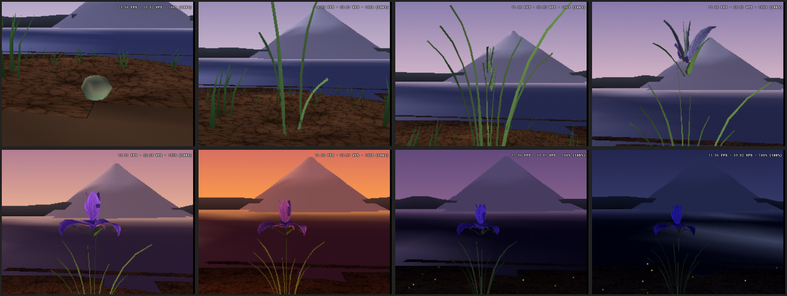

# DIGITAL IRIS

A native PlayStation 1 art demo. An iris grows from a seed on the shore of a
lake below Mt Fuji, blooms, and the day turns to sunset and then to a moonlit
night with fireflies in the grass.



*Frames captured from DuckStation, booted from the CD image through the BIOS.*

Everything is generated on the console: the terrain, the mountain, the lake,
the plant, the grass and both textures. The disc contains `SYSTEM.CNF` and one
executable and nothing else. No SDK is linked in — the ROM is bare-metal C
plus one assembly startup file, driving the GPU, DMA, GTE and SIO0 directly.

## Build

```bash
sudo apt-get install -y gcc-mipsel-linux-gnu binutils-mipsel-linux-gnu make python3
make clean && make ps1 iso
```

Produces `dist/DIRIS.EXE`, `dist/DIGITAL_IRIS.BIN` and `dist/DIGITAL_IRIS.CUE`.

```bash
python3 tools/verify_disc.py dist/DIGITAL_IRIS.BIN     # 15 structural checks
duckstation-qt -slowboot -fullscreen dist/DIGITAL_IRIS.CUE
```

Full instructions, including the BIOS situation, are in [BUILD.md](BUILD.md).

## Status, honestly

- Boots from the CD image through the normal BIOS path — **verified**.
- Runs at **15–20 fps**, not the 25–30 the brief asked for. Measured, with a
  per-section breakdown, in [reports/PERFORMANCE.md](reports/PERFORMANCE.md).
- **Silent.** The SPU is untouched.
- Tested only on DuckStation. Never run on real hardware.

Acceptance results are in [reports/SCENE_TESTS.md](reports/SCENE_TESTS.md),
the architecture in [reports/DESIGN_NOTES.md](reports/DESIGN_NOTES.md), and
everything known to be wrong or missing in
[reports/ISSUES.md](reports/ISSUES.md).

## Layout

```
include/  src/        the ROM
host/                 software model of the PS1 GPU/GTE, for art iteration
tools/                table generation, PS-X EXE and ISO packaging, verifier
reports/              acceptance results, performance, design notes, frames
reports/emulator/     screenshots taken from DuckStation
baseline/             the supplied v0.4 image and audit, preserved unchanged
art/                  the two reference paintings
dist/                 build output
```

## What is where

| File | What it does |
|---|---|
| `src/iris.c` | the ribbon grammar — every part of the plant is one primitive |
| `src/world.c` | bank, lake, far ridges, Mt Fuji, sky, wind field |
| `src/grass.c` | clustered grass with three levels of detail |
| `src/materials.c` | the two textures, synthesised on the console |
| `src/draw.c` | culling, OT insertion, and the CPU near-plane clipper |
| `src/gte_ps1.c` | COP2 driver |
| `src/platform_ps1.c` | GPU, DMA, root counters, SIO0 |
| `src/profiler.c` | on-console section timing, drawn as readable bars |
| `host/gpu_sim.c` | the software GPU used by the preview build |
